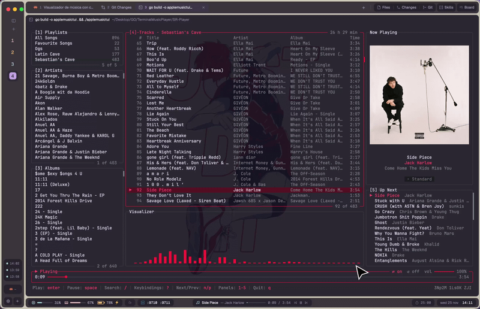

# 🎵 Apple Music TUI

> **⚠️ Work in Progress** — This project is actively under development. Features may be incomplete, unstable, or subject to change.

A terminal-based Apple Music player for macOS, built with Go. Control your Apple Music library directly from the command line with a slick, keyboard-driven TUI.


<div align="center">
  
</div>

## ✨ Features

- 🎧 **Now Playing panel** — album art rendered in the terminal using Unicode block characters, or as the real cover in Ghostty and Kitty (press `i`)
- 🪟 **Panel layout** — Playlists, Artists, Albums, Tracks and Up Next on one screen, with a live preview of whatever is selected
- 📚 **Full library browsing** — every playlist, artist and album, without paging
- 🔍 **Search** — search across your entire Apple Music library
- 📊 **Equalizer visualizer** — bars driven by the real audio output through [cava](https://github.com/karlstav/cava)
- ⌨️ **Keyboard-driven** — no mouse needed, fully navigable with hotkeys
- 🍎 **Apple ASCII art** — Apple logo on startup and when nothing is playing
- 🔀 **Shuffle & repeat** — toggle shuffle/repeat modes from the keyboard
- 🔊 **Volume control** — adjust volume inline

<br/>

## 📋 Requirements

- **macOS** (required — uses AppleScript to communicate with Apple Music)
- **Apple Music** app installed and running
- **Go 1.24+**
- **cava 1.0+** for the visualizer (`brew install cava`, macOS 14.2+). On first run, allow your terminal under *System Settings → Privacy & Security → Screen & System Audio Recording*
- A terminal with **true color** support (iTerm2, Warp, Kitty, etc.)

<br/>

## 🚀 Getting Started

### Clone & Build

```bash
git clone <repo-url>
cd SR-Player

go build -o musicplayer .
./musicplayer
```

### Run without building

```bash
go run .
```

<br/>

## ⌨️ Keybindings

| Key | Action |
|-----|--------|
| `1` – `5` | Focus Playlists / Artists / Albums / Tracks / Up Next |
| `←` `→` / `h` `l` / `Tab` | Previous / next panel |
| `↑` `↓` / `j` `k` | Move in a list |
| `PgUp` `PgDn` / `g` `G` | Move a page / first, last |
| `Enter` | Open the selection / play the track |
| `Esc` | Back to the list on the left |
| `c` | Go to the track that is playing |
| `/` | Search |
| `Space` | Play / pause |
| `n` `p` | Next / previous track |
| `,` `.` | Seek 10 s backward / forward |
| `+` `-` | Volume |
| `s` `r` | Shuffle / repeat |
| `i` | Switch album art: pixelated / photo (Ghostty and Kitty only) |
| `R` | Refresh the library |
| `?` | All keybindings |
| `q` | Quit |

---

## 🗂️ Project Structure

```
SR-Player/
├── main.go                  # Entry point
├── assets/
│   └── am-ascii.txt         # Apple ASCII art
└── internal/
    ├── applescript/         # macOS AppleScript bridge (playback, library queries)
    ├── artwork/             # Real album art (Kitty graphics protocol)
    ├── config/              # Saved preferences
    ├── cava/                # cava child process (real audio levels)
    ├── models/              # Shared data types (Track, Playlist, NowPlaying, etc.)
    └── ui/                  # TUI layout and rendering
        ├── app.go           # Main Bubble Tea model (Update loop, View)
        ├── keys.go          # Keybindings
        ├── commands.go      # Calls to Music
        ├── playback.go      # Playback context and shuffle order
        ├── layout.go        # Panel sizing
        ├── statusbar.go     # Player bar and bottom line
        ├── viewcache.go     # Redraws only what changed
        ├── theme/           # Colors
        └── panels/          # Frame, lists, now playing, visualizer, popups
```

<br/>

## 🛠️ Built With

| Library | Purpose |
|---------|---------|
| [Bubble Tea](https://github.com/charmbracelet/bubbletea) | TUI framework (Elm-like architecture) |
| [Lipgloss](https://github.com/charmbracelet/lipgloss) | Terminal styling & layout |
| [Bubbles](https://github.com/charmbracelet/bubbles) | Reusable TUI components |

<br/>

## 🚧 Next up:

- [ ] Queue editing (reorder / remove tracks)
- [ ] Lyrics view
- [ ] Playlist creation / management

<br/>

## 📄 License

MIT — see `LICENSE` for details.
